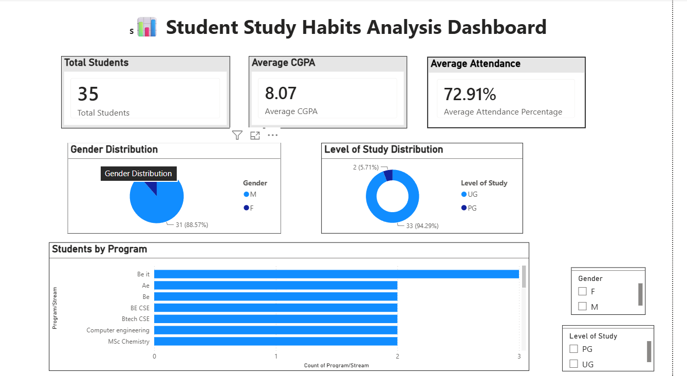
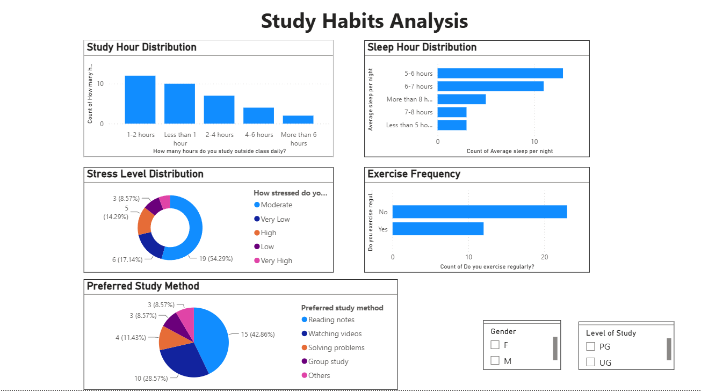
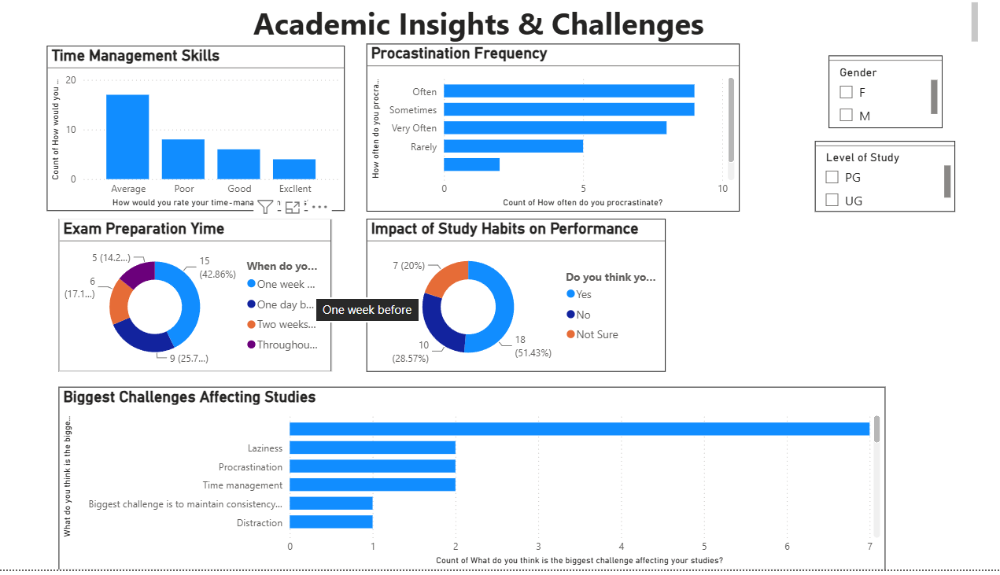

# Student Study Habits Analyzer

An end-to-end data analytics project that explores student study habits, attendance, time management, procrastination, and academic performance using **Python, Pandas, PostgreSQL, SQL, and Power BI**.

## Table of Contents

- [Project Overview](#project-overview)
- [Objectives](#objectives)
- [Key Features](#key-features)
- [Tech Stack](#tech-stack)
- [Project Workflow](#project-workflow)
- [Project Structure](#project-structure)
- [Dataset Description](#dataset-description)
- [Python Exploratory Data Analysis](#python-exploratory-data-analysis)
- [SQL Analysis](#sql-analysis)
- [Power BI Dashboard](#power-bi-dashboard)
- [Key Metrics](#key-metrics)
- [Getting Started](#getting-started)
- [Data Quality and Limitations](#data-quality-and-limitations)
- [Future Improvements](#future-improvements)
- [Author](#author)

## Project Overview

The Student Study Habits Analyzer converts raw student survey responses into structured data suitable for analysis and visualization.

Python and Pandas are used to clean and preprocess the dataset. The cleaned records are stored in PostgreSQL, where SQL queries summarize study habits and data quality. A Jupyter Notebook provides exploratory data analysis and visualizations, while Power BI presents the results through an interactive dashboard.

The project demonstrates an end-to-end data analytics workflow, from raw CSV data to database analysis and dashboard reporting.

## Objectives

- Clean and standardize raw survey data.
- Identify missing values and improve data quality.
- Explore student study habits and attendance patterns.
- Analyze time management and procrastination responses.
- Use SQL to summarize and group student responses.
- Visualize patterns through Python charts and Power BI dashboards.
- Document the analysis in a reproducible project structure.

## Key Features

- **Automated data preprocessing:** Standardizes column names, trims text, converts data types, and handles invalid numeric values.
- **Derived analytical categories:** Creates study-hour, attendance, and time-management categories.
- **PostgreSQL integration:** Loads cleaned records into a relational database using SQLAlchemy.
- **SQL-based analysis:** Uses filtering, grouping, counting, averaging, and missing-value checks.
- **Exploratory data analysis:** Uses Pandas, Matplotlib, and Seaborn in Jupyter Notebook.
- **Interactive dashboard:** Presents summary metrics and student distributions in Power BI.
- **Reproducible workflow:** Organizes scripts, SQL queries, outputs, and documentation in one repository.

## Tech Stack

| Technology | Purpose |
|---|---|
| Python | Data processing and analysis |
| Pandas | Data cleaning and manipulation |
| Matplotlib | Data visualization |
| Seaborn | Statistical plotting |
| Jupyter Notebook | Interactive exploratory data analysis |
| PostgreSQL | Relational data storage |
| SQL | Data querying and aggregation |
| SQLAlchemy | Python-to-PostgreSQL connection |
| python-dotenv | Loading local environment variables |
| Power BI | Interactive dashboards |
| Git and GitHub | Version control and project hosting |

## Project Workflow

1. **Data collection:** Load the original survey dataset from a CSV file.
2. **Data cleaning:** Standardize column names, clean text values, convert data types, normalize selected responses, and remove duplicate records.
3. **Feature creation:** Derive categories for daily study hours, attendance, and time-management skills.
4. **Data export:** Save the cleaned dataset as a CSV file.
5. **Database loading:** Store the cleaned data in PostgreSQL using SQLAlchemy.
6. **SQL analysis:** Examine student distributions, study habits, procrastination, attendance, and missing values.
7. **Python EDA:** Inspect data, calculate summary statistics, and generate visualizations in Jupyter Notebook.
8. **Dashboard development:** Connect Power BI to PostgreSQL and present key metrics and distributions.
9. **Reporting:** Document the workflow, findings, and limitations.

## Project Structure

```text
student-study-habit-analyzer/
├── data/
│   └── Study Habits Analysis .csv
├── output/
│   ├── cleaned_student_habits.csv
│   └── plots/
├── python/
│   ├── analysis_pipeline.py
│   └── Student_Study_Habits_EDA.ipynb
├── sql/
│   └── analysis_queries.sql
├── screenshots/
│   ├── overview.png
│   ├── study-habits.png
│   └── academic-insights.png
├── .gitignore
├── requirements.txt
└── README.md
```

The `.env` file is created locally and intentionally excluded from version control because it contains database credentials. The Power BI `.pbix` file may also be included if it is appropriate to share and its size is manageable.

## Dataset Description

The dataset contains **35 student responses** and 20 original survey columns.

The survey covers:

- Age, gender, level of study, and academic program
- Current CGPA or percentage
- Average attendance
- Daily study hours and weekly study consistency
- Exam preparation habits and preferred study methods
- Sleep duration and screen time
- Exercise and physical activity
- Time management and procrastination
- Stress levels and perceived academic challenges

The cleaned dataset includes additional derived categories for study habits, attendance, and time management.

## Python Exploratory Data Analysis

The Jupyter Notebook `python/Student_Study_Habits_EDA.ipynb` supports interactive analysis of the cleaned dataset.

The notebook includes:

- Dataset dimensions, column names, and data types
- Descriptive statistics
- Missing-value analysis
- Daily study-hours distribution
- Attendance-category distribution
- Procrastination frequency
- Time-management categories
- Preferred study methods
- An academic-score data-quality check

The notebook uses Pandas for analysis and Matplotlib and Seaborn for charts. The generated figures can also be saved as image files for use in reports and documentation.

[Open the Python EDA notebook](python/Student_Study_Habits_EDA.ipynb)

## SQL Analysis

The SQL script is available at `sql/analysis_queries.sql`.

It includes queries for:

- Verifying the active database
- Counting student records
- Grouping students by study category
- Analyzing attendance categories
- Analyzing time-management categories
- Examining procrastination frequency
- Checking missing values in selected columns
- Comparing recorded scores across study and attendance categories

The queries use SQL features such as `COUNT()`, `AVG()`, `GROUP BY`, `ORDER BY`, and aggregate `FILTER` clauses.

The cleaned data is stored in:

`public.student_study_habits_clean`

## Power BI Dashboard

The Power BI report presents survey results through three dashboard pages.

### 1. Overview Dashboard



Displays headline metrics and demographic distributions, including student count, recorded academic score, attendance, gender, level of study, and program.

### 2. Study Habit Analysis



Explores study-related patterns using the visuals and filters available in the report.

### 3. Academic Insights and Challenges



Presents academic-related indicators and students' reported challenges.

## Key Metrics

The current dashboard displays the following values:

| Metric | Displayed value |
|---|---:|
| Total student records | 35 |
| Average recorded CGPA | 8.07 |
| Average attendance | 72.91% |

These figures reflect the current dashboard. The academic-score average must be interpreted cautiously until the dataset's CGPA and percentage scales have been verified as consistent.

## Getting Started

### Prerequisites

Install the following software:

- Python
- PostgreSQL
- pgAdmin or another PostgreSQL client
- Power BI Desktop
- Visual Studio Code (recommended for the Jupyter Notebook)

### 1. Clone the repository

```bash
git clone <your-github-repository-url>
cd student-study-habit-analyzer
```

Replace the placeholder with your actual GitHub repository URL.

### 2. Create a virtual environment

On Windows:

```powershell
python -m venv .venv
.venv\Scripts\Activate.ps1
```

### 3. Install dependencies

```bash
python -m pip install -r requirements.txt
```

Ensure the environment includes the packages used by the pipeline and notebook, including Pandas, SQLAlchemy, psycopg2-binary, python-dotenv, Matplotlib, Seaborn, and ipykernel.

### 4. Configure PostgreSQL

Create a PostgreSQL database named `student_performance_analysis`.

Create a local `.env` file in the project root:

```env
PG_HOST=127.0.0.1
PG_PORT=5432
PG_DATABASE=student_performance_analysis
PG_USER=postgres
PG_PASSWORD=your_local_password
```

Replace the password placeholder with your own local PostgreSQL password. The variable names must match those read by `analysis_pipeline.py`.

Never commit `.env` or expose database credentials publicly.

### 5. Prepare the dataset

Place the original CSV file in the `data/` directory using the filename expected by the Python pipeline:

`Study Habits Analysis .csv`

### 6. Run the data pipeline

From the project root, run:

```powershell
python python/analysis_pipeline.py
```

The script cleans the raw dataset, exports `output/cleaned_student_habits.csv`, and loads the cleaned records into PostgreSQL.

### 7. Run the EDA notebook

Open `python/Student_Study_Habits_EDA.ipynb` in VS Code and select the project's `.venv` Python kernel.

Run the notebook cells in order. The cleaned CSV should be generated by the pipeline first.

### 8. Run SQL queries

Open `sql/analysis_queries.sql` in pgAdmin's Query Tool, connect to `student_performance_analysis`, and execute the queries.

### 9. Open Power BI

Open the Power BI report in Power BI Desktop. Configure the PostgreSQL connection for your local environment and refresh the data.

## Data Quality and Limitations

- The dataset contains only 35 student responses, so results may not represent the wider student population.
- Survey responses may contain self-reported inaccuracies.
- Some survey fields contain missing values.
- The academic-score field is labelled CGPA or percentage. These scales must be verified before their values are combined or compared.
- Attendance and study categories depend on the thresholds defined in the cleaning pipeline.
- The analysis identifies distributions and possible associations; it does not establish that a study habit causes better academic performance.

## Future Improvements

- Expand the dataset with more student responses.
- Verify and standardize academic score formats.
- Add more exploratory charts and statistical analysis.
- Improve missing-value handling and data validation.
- Add additional Power BI filters and analytical visuals.
- Automate repeatable analysis and reporting.
- Evaluate relationships between study habits and academic outcomes once the data is suitable for comparison.

## Author

**Himanshu Kumar**

